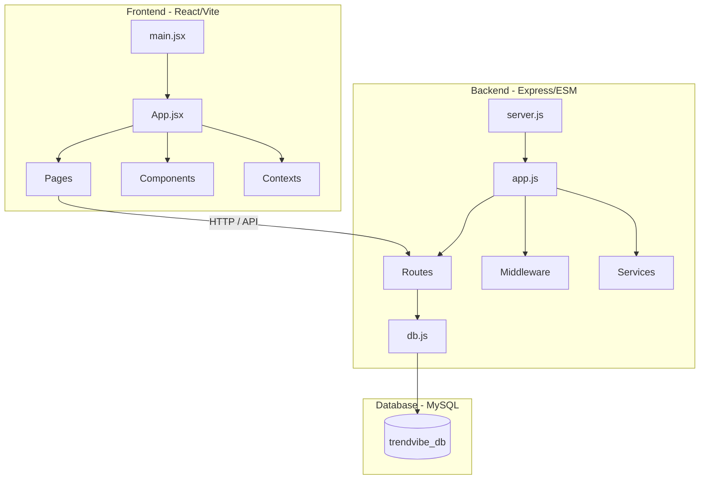

# TrendVibe Project Map

This document acts as a comprehensive reference guide to the structure, files, and feature flows of the TrendVibe web application.

---

## 📂 Project Architecture

---

## 1. ⚙️ Database Layer

The application utilizes a MySQL database named `trendvibe_db`. The connection pool and migrations are managed in:
*   [`db.js` (Backend)](file:///c:/Users/shahi/Desktop/Website/backend/src/db.js) — Establishes connection pool, creates table schemas, seeds initial values, and manages query utilities.

### Database Tables:
*   `categories`: Stores storefront classification names, header background images, and subtitles.
*   `users`: Stores usernames, emails, roles (`user` or `admin`), and bcrypt-hashed passwords.
*   `products`: Stores item catalog names, pricing, image URLs, stock, average ratings, and variant JSON arrays.
*   `product_size_inventory`: Tracks precise item stock counts per sizing option.
*   `cart_items`: Stores the shopping basket items, quantities, and chosen variants per user.
*   `orders` & `order_items`: Tracks checkout records, pricing, shipment/payment status, and purchased quantity.
*   `email_logs`: Stores record history of successfully dispatched templates and system failures.
*   `password_resets`: Holds temporary validation hashes for recovery flows.
*   `activity_logs`: Logs admin mutations for audit trails.
*   `site_settings`: Holds toggle parameters like `notification_enabled` and `notification_product_id` for custom promotions.
*   `support_queries`: Holds customer support tickets and status state.

---

## 2. 🔐 Authentication Flow

The application implements JWT authentication for standard logins, alongside template helpers to support OAuth.

*   **State Management**: [`AuthContext.jsx` (Frontend)](file:///c:/Users/shahi/Desktop/Website/frontend/src/context/AuthContext.jsx) handles user registration, token caching in local storage, login requests, and API authorization header configuration.
*   **Authentication Routes**: [`auth.js` (Backend Routes)](file:///c:/Users/shahi/Desktop/Website/backend/src/routes/auth.js) exposes login, sign up, password recovery, verification, and profile endpoints.
*   **Security Middlewares**: [`auth.js` (Backend Middleware)](file:///c:/Users/shahi/Desktop/Website/backend/src/middleware/auth.js) checks headers for authorization headers. Exposes `requireAuth` to extract JWT payloads and `requireAdmin` to enforce administrator privileges.
*   **Page Routing Guards**:
    *   [`ProtectedRoute.jsx` (Frontend)](file:///c:/Users/shahi/Desktop/Website/frontend/src/components/ProtectedRoute.jsx) — Protects user settings and cart checkouts.
    *   [`AdminRoute.jsx` (Frontend)](file:///c:/Users/shahi/Desktop/Website/frontend/src/components/AdminRoute.jsx) — Protects dashboard grids from standard access.

---

## 3. 🛍️ Main Features & File Connections

### 📦 Products & Catalog Management
*   **Controller**: [`products.js` (Backend)](file:///c:/Users/shahi/Desktop/Website/backend/src/routes/products.js)
*   **UI Views**:
    *   [`Products.jsx` (Page)](file:///c:/Users/shahi/Desktop/Website/frontend/src/pages/Products.jsx) — The main product search catalog. Uses query filters (price, categories, ratings, sizes) to retrieve filtered lists.
    *   [`ProductDetail.jsx` (Page)](file:///c:/Users/shahi/Desktop/Website/frontend/src/pages/ProductDetail.jsx) — Detailed view displaying description details, size options, color swatches, stock statuses, and the recommendation panel.
*   **Shared Card**: [`ProductCard.jsx` (Component)](file:///c:/Users/shahi/Desktop/Website/frontend/src/components/ProductCard.jsx) — Displays items across grids with quick-add cart controls and wishlist toggles.

### 🌟 Product Recommendation Engine
*   **Backend Calculations**: [`db.js`](file:///c:/Users/shahi/Desktop/Website/backend/src/db.js) implements the scoring logic inside `getProductRecommendations`:
    *   Adds points for category matches (+10), type match (+8), price range within 10%–30% (+5 to +1), and shared attribute keywords (+2 per match).
    *   Applies a prioritization boost sorting in-stock options first if the main product is out of stock.
*   **API Route**: Exposed under `/api/products/:id/recommendations` in [`products.js`](file:///c:/Users/shahi/Desktop/Website/backend/src/routes/products.js).
*   **Frontend Display**: Rendered below product details in [`ProductDetail.jsx`](file:///c:/Users/shahi/Desktop/Website/frontend/src/pages/ProductDetail.jsx) dynamically using a responsive grid of `<ProductCard>` items.

### 🛒 Shopping Cart & Checkout
*   **Context**: [`CartContext.jsx` (Frontend)](file:///c:/Users/shahi/Desktop/Website/frontend/src/context/CartContext.jsx)
*   **Endpoints**: [`cart.js` (Backend)](file:///c:/Users/shahi/Desktop/Website/backend/src/routes/cart.js)
*   **Checkout/Payment Views**:
    *   [`Cart.jsx` (Page)](file:///c:/Users/shahi/Desktop/Website/frontend/src/pages/Cart.jsx) — Basket overview.
    *   [`Checkout.jsx` (Page)](file:///c:/Users/shahi/Desktop/Website/frontend/src/pages/Checkout.jsx) — Delivery shipping form setup.
    *   [`Payment.jsx` (Page)](file:///c:/Users/shahi/Desktop/Website/frontend/src/pages/Payment.jsx) — Mock payment gate validation.
    *   [`Receipt.jsx` (Page)](file:///c:/Users/shahi/Desktop/Website/frontend/src/pages/Receipt.jsx) — Order summary invoice display.
*   **Database Syncing**: Inventory check logic is executed transactionally in `createOrder` inside [`db.js`](file:///c:/Users/shahi/Desktop/Website/backend/src/db.js) to adjust inventory levels.

### 🤖 AI Chatbot Assistant (Gemini API)
*   **Interface**: [`Chatbot.jsx` (Component)](file:///c:/Users/shahi/Desktop/Website/frontend/src/components/Chatbot.jsx) — A collapsible side-chat floating UI element.
*   **Controller**: [`chat.js` (Backend Route)](file:///c:/Users/shahi/Desktop/Website/backend/src/routes/chat.js)
*   **Engine Service**: [`geminiChatService.js` (Backend Service)](file:///c:/Users/shahi/Desktop/Website/backend/src/services/geminiChatService.js) — Integrates with the Google Gen AI library to run model conversations. Declares functional tools allowing the AI to call `search_products`, `get_product_details`, `add_to_cart`, `get_cart`, and track order stats dynamically.

### 🎛️ Administrator Dashboard
*   **Page View**: [`AdminDashboard.jsx` (Page)](file:///c:/Users/shahi/Desktop/Website/frontend/src/pages/AdminDashboard.jsx) — Dashboard containing various panels for stats, users, orders, and logs.
*   **Endpoints**: [`admin.js` (Backend Route)](file:///c:/Users/shahi/Desktop/Website/backend/src/routes/admin.js) and [`activityLogs.js` (Backend Route)](file:///c:/Users/shahi/Desktop/Website/backend/src/routes/activityLogs.js).
*   **Audit Logger**: [`activityLogger.js` (Backend Service)](file:///c:/Users/shahi/Desktop/Website/backend/src/services/activityLogger.js) writes logs on database modifications to `activity_logs`. Rendered in the frontend via the [`ActivityLogTab.jsx` component](file:///c:/Users/shahi/Desktop/Website/frontend/src/components/ActivityLogTab.jsx).

### 💱 Multi-Currency Converter
*   **State Hook**: [`CurrencyContext.jsx` (Frontend)](file:///c:/Users/shahi/Desktop/Website/frontend/src/context/CurrencyContext.jsx)
*   **Selector**: [`CurrencySelector.jsx` (Component)](file:///c:/Users/shahi/Desktop/Website/frontend/src/components/CurrencySelector.jsx) — Global navbar picker for USD, PKR, EUR, and GBP.
*   **Currency Rates API**: [`currency.js` (Backend)](file:///c:/Users/shahi/Desktop/Website/backend/src/routes/currency.js) provides base conversion values.

---

## 4. ✉️ Communication & Email Dispatcher
*   **Mailer**: [`emailService.js`](file:///c:/Users/shahi/Desktop/Website/backend/src/services/emailService.js) uses Gmail SMTP settings configured in backend `.env` via `nodemailer`.
*   **Design Layouts**: Contained in the `backend/src/templates/` folder:
    *   [`welcome.js`](file:///c:/Users/shahi/Desktop/Website/backend/src/templates/welcome.js) — Sent on user sign up.
    *   [`orderPlaced.js`](file:///c:/Users/shahi/Desktop/Website/backend/src/templates/orderPlaced.js) — Dispatched to customer on order placement.
    *   [`adminOrderPlaced.js`](file:///c:/Users/shahi/Desktop/Website/backend/src/templates/adminOrderPlaced.js) — Dispatched to admin informing about new checkout.
    *   [`orderShipped.js`](file:///c:/Users/shahi/Desktop/Website/backend/src/templates/orderShipped.js), [`orderDelivered.js`](file:///c:/Users/shahi/Desktop/Website/backend/src/templates/orderDelivered.js), etc. — State updates.
    *   [`lowStock.js`](file:///c:/Users/shahi/Desktop/Website/backend/src/templates/lowStock.js) — Alerts administrator when sizing stock hits critical bounds.
    *   [`passwordReset.js`](file:///c:/Users/shahi/Desktop/Website/backend/src/templates/passwordReset.js) — Token recovery link.
